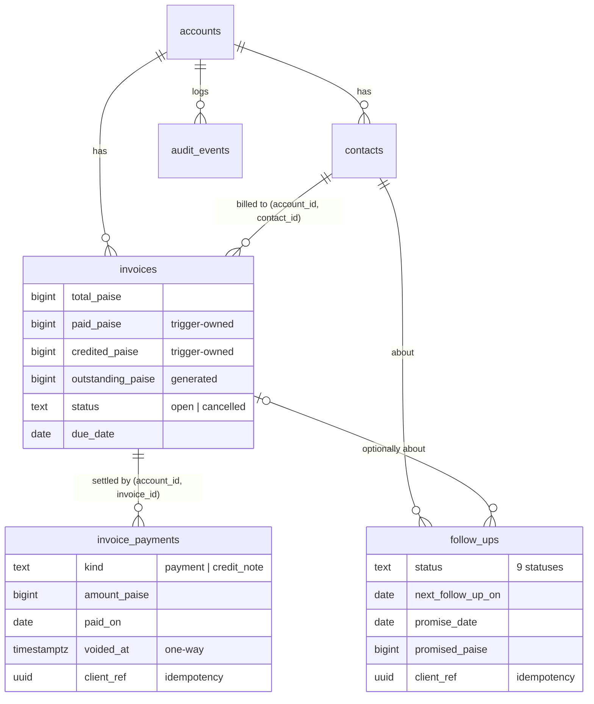

# PaisaFollow — Architecture

PaisaFollow is a **receivables module inside the wacrm modular monolith**
(Next.js 16 App Router + Supabase Postgres/Auth/RLS). It is deployed as one
app with one database. There are no microservices and no new runtime
services, and no external provider is required.

## 1. Feature reuse matrix

| Capability (brief §4) | Existing in wacrm | Decision | Where |
|---|---|---|---|
| Auth: signup, login, reset, sessions | Supabase Auth, `/login`, `/signup`, `/auth/callback`, middleware | **Reused** unchanged | `src/app/(auth)`, `src/middleware.ts` |
| One business per signup, data isolation | `accounts` + `profiles.account_id`, RLS `is_account_member()` on every table | **Reused**, and new tables follow the same policies | migrations 017/047, 060 |
| Roles | owner / admin / agent / viewer | **Reused** (viewer read-only, agent+ writes, admin+ settings, owner deletes) | `src/lib/auth/roles.ts` |
| Business profile | `accounts.name`, `default_currency` | **Extended**: timezone, address, phone, email, GSTIN, UPI ID, logo URL; INR default | 060 §1, Settings → Business profile |
| Customers | `contacts` (name, phone, email, company), phone dedupe index | **Reused as customers**; no duplicate entity | `contacts` |
| Customer CSV import | Contacts import (phone-only dedupe) | **Kept**; new invoice-centric importer added | `src/lib/receivables/import.ts` |
| Invoices, payments, credit notes | — (only `deals.value`) | **New** | `invoices`, `invoice_payments` |
| Follow-up history, promise-to-pay | `contact_notes` (free text only) | **New** structured table | `follow_ups` |
| Receivables dashboard, ageing, queue | CRM dashboard (conversations/deals) | **New**, pure functions | `overview.ts`, `queue.ts` |
| Reminder drafts (en / Hinglish / Hindi) | WhatsApp template system (Meta-approved, API-sent) | **New** deterministic drafts + free `wa.me` / SMS / email links | `reminders.ts`, `reminder-composer.tsx` |
| Official WhatsApp sending (P2) | Cloud API, templates, broadcasts, HMAC webhooks, delivery status | **Already available, not wired to reminders yet** | `src/lib/whatsapp/*` |
| AI drafting (P1, optional) | BYO-key OpenAI/Anthropic, encrypted keys, timeouts | **Available for reuse** behind a flag later | `src/lib/ai/*` |
| CSV export | Broadcast export (no formula escaping) | **New** safe exporter | `csv.ts`, `exports.ts` |
| Audit log | — | **New** trigger-written, append-only | `audit_events` |
| Account deletion / data export | — | **New** | `DELETE /api/account`, Reports |
| i18n | next-intl, 4 locales, key-parity test | **Reused**; `Receivables` namespace added | `messages/*.json` |
| Rate limiting | In-memory per-process limiter | **Reused** (new `accountDeletion` bucket) | `src/lib/rate-limit.ts` |
| Background jobs | Cron route for automations (external pinger) | **Not needed for P0** (read-time computation) | — |

**Licensing and deployment risks.** See `LICENSING.md` (public repo + MIT,
LGPL libvips) and `COSTS.md` (free-tier limits).

## 2. Data model (migration `060_receivables.sql`)



### Invariants, and where they are enforced

| Invariant | Enforced by | Test |
|---|---|---|
| Money is exact (integer paise) | `BIGINT` columns; string parser `parseAmountToPaise` | `money-dates-phone.test.ts` |
| Paid/outstanding derive only from payments | Insert forces totals to 0; `guard_invoice_write` blocks client edits; `apply_invoice_payment_totals` (SECURITY DEFINER) increments or decrements | `receivables-db.test.ts` |
| No over-payment, including concurrent writes | `CHECK (paid + credited <= total)`; increments serialise on the invoice row lock | db test "over-payment is rejected" |
| Cancelled invoices owe nothing and take no money | Generated column returns 0; CHECK forbids settlement on cancelled | db test |
| Payments are immutable | `guard_invoice_payment_write` allows only the one-way void; no DELETE policy | db test |
| Tenant isolation, even with a guessed UUID | RLS plus composite FKs `(account_id, contact_id)` / `(account_id, invoice_id)` | 8 isolation tests |
| Retries never duplicate | `UNIQUE (account_id, client_ref)` on payments and follow-ups; unique invoice number per business | db tests |
| Joining another account can't silently wipe invoices | `redeem_invitation` checks the new tables | `redeem-invitation-migration.test.ts` |
| Audit trail | AFTER triggers write `audit_events`; clients cannot write it | db test |

## 3. Computation model: everything at read time

The browser loads an RLS-scoped **snapshot** (business profile, invoices,
payments, follow-ups, referenced customers) via `useReceivables()`. It then
runs pure functions over it:

- `todayInTimeZone(account.timezone)` gives "today" for the business (default
  `Asia/Kolkata`), not the device clock.
- `status.ts` gives payment state, days overdue and ageing bucket
  (1–7, 8–30, 31+).
- `promises.ts` evaluates each promise: kept / pending / due today / missed /
  settled. Payments on or after the day it was made count towards it; credit
  notes and voided payments do not.
- `queue.ts` builds the daily queue with a deterministic score and
  human-readable reasons.
- `overview.ts` produces the dashboard figures.

There is **no scheduled job in P0**. A missed promise shows up the next
morning because the date comparison changes. Nothing can run twice, and
nothing costs anything when idle.

### Queue score (documented in the UI under "How is this list ordered?")

```
+ min(daysOverdue(oldest), 90)
+ 10 × log10(overdue ₹ + 1)
+ 25 × missed promises (max 3)
+ 40 promise due today
+ 30 scheduled follow-up due (next_follow_up_on ≤ today)
+ 20 not contacted since the oldest invoice fell due
− 40 contacted within 2 days (and nothing is due)
− 60 latest status "disputed" (also moved to a separate list)
```

A future follow-up date snoozes a customer until that date, unless a promise
is due or missed.

## 4. Reminders

`buildReminderVariables()` builds the reminder variables **only from stored
balances**. It refuses invoices that are paid or cancelled, and mixed
currencies. `renderReminder()` is strict: unknown or missing placeholders stay
visible and block sending. `findUnexpectedAmounts()` flags any ₹ figure in an
edited message that matches no real balance.

Sending is done by the user in their own app: copy, `wa.me`, `sms:` or
`mailto:`. A `reminder_sent` follow-up is written only after the user confirms
"Yes, mark as sent", using a per-composer `client_ref`.

## 5. Module map

```
supabase/migrations/060_receivables.sql   schema, triggers, RLS, redeem guard
src/lib/receivables/                      pure, unit-tested domain logic
  money · dates · phone · status · promises · queue · overview
  reminders · csv · import · import-run · exports · types
src/components/receivables/               data hook, shell, dialogs, composer
src/app/(dashboard)/receivables/          9 routes (overview, queue, invoices,
                                          invoice detail, customers, customer
                                          detail, follow-ups, import, reports)
src/components/settings/business-settings.tsx
src/app/api/account/route.ts (DELETE)     account deletion (service role)
scripts/                                  smoke test, backup/restore, demo seed
```

## 6. Scale limits and the path beyond them

The client snapshot is sized for small businesses: a few thousand invoices
per account, or a few hundred KB of JSON. Writes are single-row PostgREST
inserts guarded by the database. When a tenant outgrows this (estimate: more
than about 10,000 open invoices, or slow first loads on mobile):

1. Move `buildOverview` / `buildFollowUpQueue` behind `GET /api/receivables/*`
   route handlers. Same pure functions, so no rewrite.
2. Or push the aggregation into a `SECURITY INVOKER` SQL function. The indexes
   it needs (`idx_invoices_account_open_due` etc.) already exist.
3. Paginate invoices and follow-ups server-side with `.range()`.

## 7. Extension points (P1 / P2)

| Feature | Plan |
|---|---|
| Email reminders and daily summary | A route handler protected by a secret (same pattern as `/api/automations/cron`), triggered by GitHub Actions cron or Supabase `pg_cron`. Idempotency via a `notification_log` unique key (account, kind, local date). SMTP through a provider adapter. |
| WhatsApp Business Platform | Reuse `src/lib/whatsapp/send-message` and template approval. Record `wamid`; derive "delivered" only from webhook statuses, never from the API response. |
| AI drafting | Reuse `src/lib/ai/generate` (BYO key, timeouts). Feed it only the rendered deterministic draft and receive JSON `{text}`; re-run `findUnexpectedAmounts` on the output; fall back to the template. |
| Plans / entitlements (Phase E) | Add `accounts.plan` (`free`/`paid`) plus a pure `entitlements(plan)` checked in route handlers and, for hard limits, in triggers. No core workflow changes. |

## 8. Upstream modification inventory

These files are changed in upstream wacrm code. Re-check them when merging
`upstream/main`:

| File | Change |
|---|---|
| `vitest.config.ts` | `fileURLToPath` fix for paths containing spaces |
| `src/middleware.ts` | `/receivables` added to `protectedPaths` |
| `src/components/layout/sidebar.tsx` | "Receivables" nav item |
| `src/components/layout/header.tsx` | page title mapping |
| `src/components/settings/settings-sections.ts`, `src/app/(dashboard)/settings/page.tsx` | "Business profile" section |
| `src/app/api/account/route.ts` | `DELETE` handler added (GET/PATCH untouched) |
| `src/lib/rate-limit.ts` | `accountDeletion` bucket |
| `supabase/ci/verify-schema.sql` | 060 assertions appended inside the DO block |
| `supabase/migrations/060_receivables.sql` | **re-creates `redeem_invitation`** (047 body plus 4 tables). If upstream changes that function, merge both. |
| `messages/{en,es,ko,pt}.json` | new keys (es/ko/pt hold English copies) |
| `package.json` | `test:smoke` script; dev deps `@electric-sql/pglite`, `@electric-sql/pglite-pgvector` |
| `README.md` | rewritten for PaisaFollow |

Everything else is additive (new files). Pull upstream security fixes with:

```bash
git fetch upstream && git merge upstream/main   # then: npm ci && npm test && npm run build
```
